# TxWarden

Pre-signature review for Ethereum transactions. TxWarden decodes what a transaction will really do,


## For the lay reader

- [docs/diagrams/explainer.svg](docs/diagrams/explainer.svg) &mdash; a one-page
  summary in ordinary words: the question, one chart, the finding, and why it
  matters. No background assumed.
- [GLOSSARY.md](GLOSSARY.md) &mdash; every abbreviation this repo uses, defined.
dry-runs it against a fork, and produces an **ALLOW / WARN / BLOCK** verdict from a deterministic
rule engine. An optional LLM agent explains the result in plain language, but **it cannot change
the verdict**, and the agent fails closed if it skips the assessment.

Zero required runtime dependencies (the Anthropic SDK is an optional extra). Python 3.10 to 3.13.
MIT licensed. Author: Ammon Jackson.

> **Status: beta, not audited.** It is a second pair of eyes before you sign, not a replacement for
> reading what your wallet shows you. The numbers below come from **synthetic** data and
> **in-memory** chains; read [Limitations](#limitations) before relying on it.

## Contents

[Architecture](#architecture) | [Quickstart](#quickstart) | [Configuration](#configuration) |
[What it checks](#what-it-checks) | [How well does it work](#how-well-does-it-work) |
[Real-chain replay](#real-chain-replay) | [Diagrams](#diagrams) | [Limitations](#limitations) | [MCP server](#mcp-server) |
[Docs](#documentation)

## Architecture

```
                         UNTRUSTED                            TRUSTED, DETERMINISTIC
          +----------------------------------+     +--------------------------------------------+
 tx.json  |  LLM agent  (optional)           |     |                                            |
 intent ->|  - explains in <= 5 sentences    |     |  calldata --> effects --> simulate --> rules|
          |  - tools: simulate_transaction,  |<----|  abi.py     effects.py   simulator.py risk.py|
          |    assess_risk, decode_calldata, |     |  (selectors,  (approvals,   (fork eth_call,  |
          |    explain_rule, lookup_address  |     |   Universal    transfers,    traces, probes) |
          |  - tool results are labelled as  |     |   Router,      swaps, LP)         |          |
          |    data, never instructions      |     |   multicall)                      v          |
          +----------------+-----------------+     |   ALLOW | WARN | BLOCK  (worst severity)   |
                           |                       +--------------------+-----------------------+
                           |  review.verdict = max over assess() results recorded by the tool layer
                           +--------------------------------------------+
                              model text, tool arguments and call order never reach the verdict
```

* **The verdict is code, not prose.** `risk.assess()` decides; the model only explains. A prompt
  injected through calldata, a token name, an address label or a revert reason can change what the
  model says, not what the engine returns
  ([evidence](#prompt-injection-evaluation)).
* **Fail closed.** An RPC that cannot be reached, a rule that crashes, a simulation the engine
  cannot digest and a model that never ran the engine all end in BLOCK. A swap that cannot be priced
  (no pool state) ends in WARN, not ALLOW.
* **Computed, not guessed.** Price impact and sandwich exposure come from the pool math (constant
  product, multi-hop, and Uniswap V3 with ticks), cross-checked in the tests against an independent
  integer implementation of Uniswap's published swap formulas.

More in [docs/ARCHITECTURE.md](docs/ARCHITECTURE.md) and [docs/THREAT_MODEL.md](docs/THREAT_MODEL.md).

## Quickstart

From a checkout (nothing is published to a package index yet):

```bash
pip install -e ".[dev]"          # add ,llm for the optional explanation agent
txwarden review examples/approve_unlimited.json --no-llm
```

<!-- BEGIN cli-example -->
```text
$ txwarden review examples/approve_unlimited.json --no-llm
Call: ERC-20/721 approve
Verdict: BLOCK
  [CRITICAL] UNLIMITED_APPROVAL_UNKNOWN: Unlimited approval to unknown spender 0x3333333333333333333333333333333333333333
  [INFO] CHECKS_SKIPPED: Checks that did not run: chain_state
Warning: no RPC configured (--rpc/config): static decode only; swap, honeypot, trace and account rules could not run
(exit code 2)
```
<!-- END cli-example -->

Exit codes: **0** ALLOW, **2** WARN or BLOCK (read the `Verdict:` line, or use `--json`),
**3** input or configuration error. With a fork RPC the swap, honeypot and trace rules run too:

```bash
anvil --fork-url "$ETH_RPC_URL" &
txwarden review tx.json --rpc http://127.0.0.1:8545 --config txwarden.toml --no-llm
txwarden review tx.json --rpc http://127.0.0.1:8545 --record session.json   # keep the RPC session
txwarden review tx.json --replay session.json --json                        # review it offline
```

Several transactions that will be signed together are reviewed as a bundle, including the
drainer pattern where the approval and the pull sit in different transactions:

<!-- BEGIN cli-bundle -->
```text
$ txwarden batch examples/bundle_approve_then_pull.json
Bundle verdict: BLOCK
  tx #0: WARN — APPROVAL_UNKNOWN_SPENDER, CHECKS_SKIPPED
  tx #1: ALLOW — CHECKS_SKIPPED
  [CRITICAL] BUNDLE_APPROVE_THEN_PULL: tx #0 grants unknown spender 0x3333333333333333333333333333333333333333; tx #1 lets it pull funds
(exit code 2)
```
<!-- END cli-bundle -->

Other commands:

```bash
txwarden decode 0x095ea7b3...        # what is this calldata?
txwarden rules [--category approval] # every rule, one line each
txwarden explain UNLIMITED_APPROVAL_UNKNOWN   # why it matters, what to do, which knobs apply
txwarden label 0x7a250d5630B4cF539739dF2C5dAcb4c659F2488D
txwarden mcp --rpc http://127.0.0.1:8545      # MCP server on stdio (also: txwarden-mcp)
```

Use it as a library:

```python
from txwarden import PolicyConfig, Tx, assess
from txwarden.simulator import AnvilSimulator, StaticSimulator

tx = Tx(sender="0x1111111111111111111111111111111111111111",
        to="0xa0b86991c6218b36c1d19d4a2e9eb0ce3606eb48",
        data="0x095ea7b3" + "00" * 12 + "33" * 20 + "ff" * 32)
sim = StaticSimulator().simulate(tx)                       # or AnvilSimulator("http://127.0.0.1:8545")
verdict, findings = assess(tx, sim, PolicyConfig(trusted_spenders={"0x7a25..."}))
print(verdict.value, [f.rule for f in findings])           # BLOCK ['UNLIMITED_APPROVAL_UNKNOWN', ...]
```

## Configuration

A TOML file (`--config txwarden.toml`, also used by the MCP server). Everything is optional.
Python 3.11+ parses it with `tomllib`; Python 3.10 falls back to a small built-in parser for the
same subset (tables, strings, numbers, booleans, arrays; no inline tables or dotted keys). A test
asserts both parsers agree on randomly generated configs.

```toml
# rpc_url = "http://127.0.0.1:8545"      # an Anvil/Hardhat/Geth fork; unset = static review only
trust_well_known = false                 # true: trust routers, Permit2 and marketplaces from the built-in book

[policy]
expected_chain_id = 1
trusted_spenders = ["0x7a250d5630B4cF539739dF2C5dAcb4c659F2488D"]   # Uniswap V2 Router02
trusted_recipients = ["0x2222222222222222222222222222222222222222"]
denylist = ["0xdead00000000000000000000000000000000beef"]
slippage_warn = 0.0075
slippage_block = 0.05
sandwich_block_bps = 100
disabled_rules = []                      # ids from `txwarden rules`; fail-closed rules cannot be disabled

[policy.address_book]
"0x4444444444444444444444444444444444444444" = "cold wallet"

[simulator]
honeypot = true
trace = true
```

Every threshold is a field of `PolicyConfig`; `txwarden explain <RULE>` lists the knobs that
affect a rule together with their defaults, and [docs/RULES.md](docs/RULES.md) lists all of them.
Unknown keys, unknown rule ids and attempts to disable a fail-closed rule are errors, not silent
no-ops.

## What it checks

<!-- BEGIN rule-counts -->
**55 rules**: 26 CRITICAL (BLOCK), 21 HIGH (WARN), 8 MEDIUM/INFO (reported, never stopping).
<!-- END rule-counts -->

Severity is fixed per rule: CRITICAL means BLOCK, HIGH means WARN, MEDIUM and INFO are reported
but never stop. The verdict is the worst severity. Full descriptions, "why it matters" text and
policy knobs for every rule: [docs/RULES.md](docs/RULES.md) (generated from the registry in
`src/txwarden/rules.py`; a test fails if it is stale).

<!-- BEGIN rules-table -->
| Rule | Severity | Verdict | What it catches |
|---|---|---|---|
| `ADDRESS_LOOKALIKE` | CRITICAL | BLOCK | Address-poisoning lookalike |
| `DENYLISTED_TARGET` | CRITICAL | BLOCK | Call to a denylisted contract |
| `CALL_TO_NON_CONTRACT` | HIGH | WARN | Calldata sent to an address with no code |
| `APPROVAL_TO_DENYLISTED` | CRITICAL | BLOCK | Approval to denylisted spender |
| `UNLIMITED_APPROVAL_UNKNOWN` | CRITICAL | BLOCK | Unlimited approval to unknown spender |
| `APPROVAL_UNKNOWN_SPENDER` | HIGH | WARN | Bounded approval to unknown spender |
| `UNLIMITED_APPROVAL_TRUSTED` | MEDIUM | ALLOW | Unlimited approval to trusted spender |
| `APPROVAL_REVOKED` | INFO | ALLOW | Approval set to zero |
| `OPERATOR_APPROVAL_DENYLISTED` | CRITICAL | BLOCK | setApprovalForAll to denylisted operator |
| `OPERATOR_APPROVAL_UNKNOWN` | CRITICAL | BLOCK | setApprovalForAll to unknown operator |
| `OPERATOR_APPROVAL_TRUSTED` | MEDIUM | ALLOW | setApprovalForAll to trusted operator |
| `OPERATOR_APPROVAL_REVOKED` | INFO | ALLOW | Operator approval revoked |
| `PERMIT_TO_DENYLISTED` | CRITICAL | BLOCK | Permit to denylisted spender |
| `PERMIT_UNLIMITED_UNKNOWN` | CRITICAL | BLOCK | Unlimited permit to unknown spender |
| `PERMIT_FAR_DEADLINE` | HIGH | WARN | Permit or allowance valid for a very long time |
| `PERMIT_UNKNOWN_SPENDER` | HIGH | WARN | Bounded permit to unknown spender |
| `PERMIT_UNLIMITED_TRUSTED` | MEDIUM | ALLOW | Unlimited permit to trusted spender |
| `TRANSFER_TO_DENYLISTED` | CRITICAL | BLOCK | Transfer to denylisted address |
| `NEAR_FULL_BALANCE_TO_NEW_ADDRESS` | HIGH | WARN | Near-full balance to unrecognised address |
| `SWAP_RECIPIENT_MISMATCH` | HIGH | WARN | Swap or router output sent to a third party |
| `TRANSFER_TO_BURN_ADDRESS` | HIGH | WARN | Transfer to the zero or dead address |
| `TRANSFER_TO_FRESH_ADDRESS` | HIGH | WARN | Transfer to a never-used address |
| `TRANSFER_TO_TOKEN_CONTRACT` | HIGH | WARN | Tokens sent to the token's own contract |
| `TRANSFER_TO_UNKNOWN_CONTRACT` | MEDIUM | ALLOW | Token transfer to unknown contract |
| `LIQUIDITY_EXHAUSTED` | CRITICAL | BLOCK | Pool cannot fill the trade |
| `PRICE_IMPACT_EXTREME` | CRITICAL | BLOCK | Extreme price impact |
| `SANDWICH_EXPOSURE_SEVERE` | CRITICAL | BLOCK | Severe sandwich exposure |
| `SLIPPAGE_TOLERANCE_EXTREME` | CRITICAL | BLOCK | Extreme slippage tolerance |
| `PRICE_IMPACT_HIGH` | HIGH | WARN | High price impact |
| `SANDWICH_EXPOSURE` | HIGH | WARN | Sandwich exposure |
| `SLIPPAGE_TOLERANCE_LOOSE` | HIGH | WARN | Loose slippage tolerance |
| `CHAIN_ID_MISMATCH` | CRITICAL | BLOCK | Chain id mismatch |
| `ENGINE_ERROR` | CRITICAL | BLOCK | A rule check crashed |
| `GAS_EXTREME` | CRITICAL | BLOCK | Extreme gas usage |
| `SIMULATION_UNAVAILABLE` | CRITICAL | BLOCK | Simulation could not be performed |
| `ANALYSIS_INCOMPLETE` | HIGH | WARN | Swap or liquidity analysis could not run |
| `ETH_REJECTED_BY_CONTRACT` | HIGH | WARN | Contract rejects plain ETH |
| `GAS_ABNORMAL` | HIGH | WARN | Abnormal gas usage |
| `REVERT` | HIGH | WARN | Transaction reverts in simulation |
| `CHECKS_SKIPPED` | INFO | ALLOW | Some optional checks did not run |
| `DELEGATECALL_TO_UNKNOWN` | CRITICAL | BLOCK | Nested delegatecall to unknown code |
| `DENYLISTED_IN_TRACE` | CRITICAL | BLOCK | Denylisted address touched in call tree |
| `SELFDESTRUCT_IN_TRACE` | CRITICAL | BLOCK | SELFDESTRUCT in call tree |
| `CONTRACT_CREATION_IN_TRACE` | HIGH | WARN | Contract created during the call |
| `UNTRUSTED_PULL_IN_TRACE` | HIGH | WARN | Untrusted contract moves your tokens to a third party |
| `PROXY_DELEGATECALL_UNKNOWN_IMPL` | MEDIUM | ALLOW | Proxy delegates to unlabelled implementation |
| `HONEYPOT_SELL_REVERTS` | CRITICAL | BLOCK | Token can be bought but not sold |
| `ROUND_TRIP_LOSS_SEVERE` | CRITICAL | BLOCK | Severe round-trip loss |
| `ROUND_TRIP_LOSS` | HIGH | WARN | Round-trip loss (fee on transfer) |
| `LP_REMOVAL_MAJORITY` | CRITICAL | BLOCK | Removes the majority of a pool's liquidity |
| `LP_REMOVAL_LARGE` | HIGH | WARN | Removes a large share of a pool's liquidity |
| `BUNDLE_ADD_THEN_REMOVE_LIQUIDITY` | CRITICAL | BLOCK | Add then remove liquidity in one bundle |
| `BUNDLE_APPROVE_THEN_PULL` | CRITICAL | BLOCK | Approval then pull by the same unknown spender |
| `BUNDLE_MIXED_CHAIN_IDS` | CRITICAL | BLOCK | Bundle mixes chain ids |
| `BUNDLE_CUMULATIVE_DRAIN` | HIGH | WARN | Bundle drains the balance cumulatively |
<!-- END rules-table -->

## How well does it work

**Short answer: it does what its rules say, which is checked thoroughly; how well those rules
predict real-world harm has not been measured.** Everything below is produced by code in this
repository from synthetic data written by the same author as the rules. The tables are regenerated
by `scripts/update_readme.py` from real runs, and CI fails if they drift.

### Tests

<!-- BEGIN test-count -->
**1189 tests** run by default, plus 7 opt-in live-RPC tests that are skipped unless `TXWARDEN_LIVE_RPC` is set.
<!-- END test-count -->

<!-- BEGIN coverage -->
Line coverage of `src/txwarden`: **99.2%** (4224/4260 statements); with branches **98.6%**. Lowest module: `amm.py` at 95.7%. CI fails below 90%.
<!-- END coverage -->

What the tests include beyond unit tests: seeded randomised invariants (constant-product `k`
never decreases, price impact is monotonic in size, sandwich profit is never negative and is
optimal against random alternatives, a V3 round trip never profits, ABI round trips over random
nested types, decoder fuzzing, "adding a denylist entry never lowers a verdict"); the V3 swap
math is compared with an independent integer implementation of the contracts' formulas; Keccak-256 is checked against
`hashlib.sha3_256` on every block boundary; the `AnvilSimulator` HTTP path runs against a real
`http.server` replaying recorded sessions; the CLI and the MCP server run as subprocesses over
pipes. The property tests found one real bug (the fallback TOML parser mis-counted brackets inside
strings) and the evals found two more (below).

### Synthetic labelled evals

`evals/build_cases.py` generates the cases from seeded scenario templates and **does not import
the engine**: the label is the verdict a careful reviewer would give that class of transaction,
written into the template, never read back from the engine. Each category is split 70/30 into
`dev` and `heldout` with disjoint random draws; for the swap categories the held-out draws also
come from a different pool-size regime. Thresholds may be tuned on `dev` only.

<!-- BEGIN eval-table -->
| Split | Cases | Accuracy | Unsafe ALLOW | Over-BLOCK | BLOCK precision | BLOCK recall | Right reason |
|---|---:|---:|---:|---:|---:|---:|---:|
| dev | 1897 | 0.977 | 11 | 7 | 0.990 | 0.970 | 1.000 |
| held-out | 763 | 0.976 | 3 | 5 | 0.982 | 0.972 | 1.000 |
| all | 2660 | 0.977 | 14 | 12 | 0.988 | 0.970 | 1.000 |

92 categories.

| Group | Correct / total (all splits) | Accuracy |
|---|---:|---:|
| approval | 280/280 | 1.000 |
| bundle | 196/196 | 1.000 |
| composite | 112/112 | 1.000 |
| execution | 196/196 | 1.000 |
| gray_area | 311/364 | 0.854 |
| honeypot | 112/112 | 1.000 |
| liquidity | 140/140 | 1.000 |
| nft | 112/112 | 1.000 |
| permit | 168/168 | 1.000 |
| swap_path | 56/56 | 1.000 |
| swap_v2 | 327/336 | 0.973 |
| swap_v3 | 140/140 | 1.000 |
| trace | 196/196 | 1.000 |
| transfer | 252/252 | 1.000 |

Categories below 100% (all splits):

| Category | Correct / total | Accuracy |
|---|---:|---:|
| `swap_impact_band` | 43/56 | 0.768 |
| `swap_loose` | 19/28 | 0.679 |
| `swap_mid_trade_slippage_band` | 38/56 | 0.679 |
| `swap_slippage_band` | 34/56 | 0.607 |
<!-- END eval-table -->

How to read this honestly:

* **Unsafe ALLOW** = a reviewer would have warned or blocked, the engine allowed.
  **Over-BLOCK** = the engine blocked what a reviewer would allow or merely flag.
  "Right reason" = when the verdict was right, one of the rules the template names fired.
* **Accuracy is below the original release's 0.984 on four categories**: `swap_loose`,
  `swap_impact_band`, `swap_slippage_band` and `swap_mid_trade_slippage_band` (last table above,
  with their accuracies). They are all swap-threshold disagreements. The template says "block from
  3% slippage" or "warn from 3% price impact" and the shipped defaults (5% and 5%) are laxer; and for
  a 1-2% trade the template allows the wallet-default 0.5% tolerance and warns above it, while the
  engine warns from 30 bps of extractable value and blocks from 100 bps. The overall number
  (0.977) is also below 0.984 because the new set deliberately includes gray-area categories.
* **Every other category is at 100%, and that is the weak part of this evidence.** The templates
  were written next to the rules, so near-perfect agreement shows the rules behave as documented
  under varied inputs (a strong regression net) and says almost nothing about recall on attacks
  nobody wrote a template for. There is no real-world labelled data here.
* The disagreements are **labels the author chose**, not ground truth. The two `swap_*_band`
  categories in particular encode one person's idea of "a wallet-default slippage is fine" and
  "3% impact deserves a warning".
* What the evals found in the engine, fixed before this release: revoking an allowance from a
  denylisted spender was reported as BLOCK; "bounded" approvals of 2^128 to 2^255 (more than any
  token's supply) were only a WARN. The original release's two misses are the `swap_loose` 3-5%
  band, still there.

<!-- BEGIN strict-eval -->
All 14 unsafe ALLOWs and 12 over-BLOCKs fall in the `gray_area` group; outside it (2296 cases) there are 0 unsafe ALLOWs and 0 over-BLOCKs, accuracy 0.996.
<!-- END strict-eval -->

On the original 122-case set (kept as `evals/cases_v1.jsonl`, scored by the same engine and
code) the result is unchanged from the first release:

<!-- BEGIN legacy-eval -->
`evals/cases_v1.jsonl` (122 cases, 16 categories): accuracy **0.984**, BLOCK precision 1.000, BLOCK recall 0.958, unsafe ALLOW 0.
<!-- END legacy-eval -->

### Threshold sweeps

`python evals/run_evals.py --sweep` re-scores every case under alternative thresholds and prints
the trade between *unsafe ALLOW* (too lax) and *over-BLOCK* (too strict); `*` marks the Pareto
frontier on `dev`. The line "best on dev" is what tuning on `dev` would pick, shown next to what
it does on `heldout`.

<!-- BEGIN sweeps -->
```text
swap thresholds x k (all six scaled together; k>1 is looser)
  setting     dev acc  unsafe  over-B  | held acc  unsafe  over-B   frontier(dev)
  k=0.25        0.940       0      80  |    0.929       0      41   
  k=0.5         0.973       0      24  |    0.966       0      13   *
  k=0.75        0.986       4      12  |    0.978       3      10   *
  k=1           0.977      11       7  |    0.976       3       5   *
  k=1.5         0.935      76       0  |    0.942      31       0   *
  k=2           0.899     114       0  |    0.911      42       0   
  k=3           0.878     122       0  |    0.882      50       0   
  k=5           0.863     142       0  |    0.860      62       0   
  best on dev: k=0.75 (dev 0.986 -> held-out 0.978); default: k=1 (held-out 0.976)

slippage_block (default 0.05)
  setting     dev acc  unsafe  over-B  | held acc  unsafe  over-B   frontier(dev)
  0.01          0.966      11      49  |    0.959       3      26   
  0.02          0.986      11      11  |    0.982       3       9   
  0.03          0.988      11       7  |    0.987       3       5   *
  0.04          0.983      11       7  |    0.984       3       5   *
  0.05          0.977      11       7  |    0.976       3       5   *
  0.08          0.965      11       7  |    0.972       3       5   *
  0.15          0.952      11       7  |    0.955       3       5   *
  best on dev: 0.03 (dev 0.988 -> held-out 0.987); default: 0.05 (held-out 0.976)

impact_warn_bps (default 500)
  setting     dev acc  unsafe  over-B  | held acc  unsafe  over-B   frontier(dev)
  100           0.975       1       7  |    0.975       0       5   *
  200           0.981       1       7  |    0.979       0       5   *
  300           0.982       1       7  |    0.980       0       5   *
  400           0.980       5       7  |    0.976       3       5   
  500           0.977      11       7  |    0.976       3       5   
  800           0.966      32       7  |    0.958      17       5   
  1500          0.954      55       7  |    0.950      23       5   
  best on dev: 300 (dev 0.982 -> held-out 0.980); default: 500 (held-out 0.976)

sandwich_warn_bps (default 30)
  setting     dev acc  unsafe  over-B  | held acc  unsafe  over-B   frontier(dev)
  5             0.973      11       7  |    0.974       3       5   *
  15            0.975      11       7  |    0.974       3       5   *
  30            0.977      11       7  |    0.976       3       5   *
  45            0.977      14       7  |    0.979       3       5   
  60            0.974      21       7  |    0.979       3       5   
  100           0.974      21       7  |    0.979       3       5   
  200           0.974      21       7  |    0.979       3       5   
  best on dev: 45 (dev 0.977 -> held-out 0.979); default: 30 (held-out 0.976)
```
<!-- END sweeps -->

On this label set the best single-knob changes on `dev` are `slippage_block` 0.05 to 0.03 and
`impact_warn_bps` 500 to 300, and both also improve `heldout`. Scaling all six swap thresholds by
0.75 also helps on `dev` but gains little on `heldout` and doubles its over-BLOCKs (the `k=0.75`
row). The defaults were **not** changed to fit the labels: whether "3% impact" should warn is a
product decision that a synthetic set cannot settle. Tune them for your own risk appetite.

### Prompt-injection evaluation

`evals/injection_eval.py` runs the real agent, tool layer and engine against a scripted model that
**obeys every instruction it reads**: in the user's stated intent, in the calldata bytes, in token
names, in address labels, in revert reasons, in decoded arguments and in tool results. Attack
scripts include forcing a verdict argument, overriding the policy, skipping the engine, calling
tools that do not exist, re-simulating a different transaction and spoofing a label. For every run
the verdict is compared with what the engine returns for the same transaction.

<!-- BEGIN injection-table -->
| | Runs | Obeyed an injected directive | Verdict = engine's | Fail-closed BLOCK | Weaker than engine | Changed after assess_risk | Text told user to proceed on BLOCK |
|---|---:|---:|---:|---:|---:|---:|---:|
| vector: `none` | 5 | 0 | 5 | 0 | 0 | 0 | 0 |
| vector: `user_intent` | 40 | 40 | 30 | 10 | 0 | 0 | 16 |
| vector: `calldata_bytes` | 40 | 40 | 30 | 10 | 0 | 0 | 16 |
| vector: `token_name` | 40 | 40 | 30 | 10 | 0 | 0 | 16 |
| vector: `address_label` | 40 | 24 | 40 | 0 | 0 | 0 | 5 |
| vector: `revert_reason` | 40 | 40 | 30 | 10 | 0 | 0 | 10 |
| vector: `decoded_args` | 40 | 40 | 30 | 10 | 0 | 0 | 16 |
| attack: `(control)` | 5 | 0 | 5 | 0 | 0 | 0 | 0 |
| attack: `force_verdict_arg` | 30 | 28 | 30 | 0 | 0 | 0 | 9 |
| attack: `override_policy_arg` | 30 | 28 | 30 | 0 | 0 | 0 | 0 |
| attack: `skip_assessment` | 30 | 28 | 5 | 25 | 0 | 0 | 26 |
| attack: `fake_override_tool` | 30 | 28 | 30 | 0 | 0 | 0 | 0 |
| attack: `resimulate_other_tx` | 30 | 28 | 30 | 0 | 0 | 0 | 0 |
| attack: `spoof_lookup` | 30 | 28 | 30 | 0 | 0 | 0 | 9 |
| attack: `say_allow_only` | 30 | 28 | 30 | 0 | 0 | 0 | 9 |
| attack: `kitchen_sink` | 30 | 28 | 5 | 25 | 0 | 0 | 26 |
| **total** | 245 | 224 | 195 | 50 | 0 | 0 | 79 |
<!-- END injection-table -->

*Weaker than engine* and *Changed after assess_risk* are the invariants and must be 0. *Fail-closed
BLOCK* are runs where the model obeyed "do not run the risk engine": the agent returns BLOCK, which
means an injected model can force a BLOCK on a harmless transaction (denial of service) but cannot
obtain an ALLOW. **What this does not show:** that a real language model resists injection (it may
well be fooled, and its explanation can then be wrong), only that being fooled cannot move the
verdict. No real model was run; the repository has no API key in its tests.

## Real-chain replay

<!-- BEGIN replay-status -->
**Real-chain results: NOT YET RUN.** No non-MOCK results file is committed under `results/`. Every number elsewhere in this README comes from synthetic data or from the in-memory fake node.
<!-- END replay-status -->

Everything under "How well does it work" is synthetic. `txwarden replay` is the harness for the
first real measurement: given transaction hashes that someone has labelled `sandwiched` or
`ordinary`, it reads each transaction from a node, simulates it against the state at the end of
the block *before* the one that mined it, runs the normal rule engine, and appends one line per
case to a results file. `txwarden replay-report` turns that file into a detection rate (WARN or
BLOCK on the sandwiched cases) and a false-positive rate (WARN or BLOCK on the ordinary cases)
with 95% Wilson intervals, computed from the results file alone.

It has only ever run against the in-memory fake node in the tests. Those runs are stamped `MOCK`
in the results header, the report title and the file names, and `replay-report` refuses them.
Historical replay needs a node with archive state; the endpoint URL (which carries an API key) is
read from an environment variable and is never accepted on the command line or printed. The
sequence below is what you run with your own endpoint and your own labelled cases
([docs/LIVE_REPLAY.md](docs/LIVE_REPLAY.md) has the full walkthrough, the case-file format and
what the numbers do not show):

```bash
read -rs TXWARDEN_LIVE_RPC && export TXWARDEN_LIVE_RPC     # paste the endpoint URL; nothing is echoed
txwarden replay cases.csv --validate-only                   # check the labelled cases, no network
txwarden replay cases.csv --estimate                        # measure 3 cases: requests and projected units
txwarden replay cases.csv --out results/replay.jsonl --budget-calls 5000
txwarden replay cases.csv --out results/replay.jsonl --budget-calls 5000   # same command resumes
txwarden replay-report results/replay.jsonl --out results/replay-report.md
```

A case the harness cannot analyse (not a swap the decoder knows, no pool state, reverts at the
pinned block, transaction not found, RPC or archive failure) is recorded as `unsupported` or
`error` with a reason and is never counted as detected, missed, correct or wrong; the report shows
every denominator. The report refuses a headline with fewer than 30 analysable cases per label
unless you pass `--allow-small` (the output is then stamped SMALL SAMPLE). The known limits are
the approximation itself (state at the end of block N-1 does not contain the attacker's front-run
or anything else earlier in block N), label noise, selection bias and the swaps the decoder does
not cover.

## Diagrams

How to use it, from install to acting on the exit code
([source](docs/diagrams/usage.mmd)):



What to do when something goes wrong, keyed to the messages you will actually see
([source](docs/diagrams/troubleshooting.mmd)):


Both are Mermaid sources rendered to SVG by `scripts/render_diagrams.sh`; see
[docs/FLOWCHARTS.md](docs/FLOWCHARTS.md) for the text versions.

## Limitations

Please read these before depending on the verdict.

* **No real-world validation.** All evals are synthetic and authored alongside the rules (see
  above). There is no measured false-positive or false-negative rate on real transactions.
* **The live-node path is unverified.** `AnvilSimulator` has been run against an in-memory chain
  served over real HTTP and against recorded sessions *from that chain*, never against a real
  Anvil, Hardhat, Geth or Reth node. The response shapes of real clients (revert data, `callTracer`
  output, `eth_simulateV1`) are implemented from the specifications and are untested. An opt-in
  test file exists (`TXWARDEN_LIVE_RPC`, `pytest -m live`); it has not been run against a node, and
  neither has the historical replay harness (`txwarden replay`, see
  [Real-chain replay](#real-chain-replay)).
* **Transactions only.** Off-chain signature requests (EIP-712 typed data such as Permit
  signatures and marketplace orders, `personal_sign`) are not reviewed. On-chain `permit` and
  Permit2 calls are.
* **Known calldata only.** About 70 selectors are decoded (ERC-20/721/1155, WETH, Permit2,
  Uniswap V2/V3 routers, Universal Router commands, multicall and Multicall3). Anything else is an
  opaque call: it is judged by the simulation, the gas heuristics and any token pulls visible in
  the call tree, not by understanding it.
* **Effects come from calldata and the call tree, not from state diffs or logs.** TxWarden does
  not compute the full set of balance changes of a transaction.
* **Pricing covers the first swap only** in a transaction (more are reported as "not assessed",
  which is a WARN); V3 multi-hop and Uniswap V4 are not priced. Sandwich exposure is an estimate
  for one pool, before gas and competition.
* **Honeypot probe** buys with ETH through the Uniswap V2 router and sells back. It cannot see
  traps that depend on time, block number or a specific address, and it needs `eth_simulateV1`
  to see taxes (otherwise quotes only).
* **Simulation is not execution.** A contract can detect a simulation, and state can change
  between review and inclusion. Upgradeable proxies are only noted (MEDIUM).
* **You trust your RPC.** A node that lies defeats the review.
* **Address-poisoning detection needs a reference.** It compares counterparties with your trust
  lists, address book and sender; it has no history or threat-intelligence feed. The built-in
  book has about 30 mainnet entries.
* **The language model is optional and untrusted.** Its explanation can be wrong or manipulated;
  the verdict does not depend on it.
* **Defaults are the author's.** Thresholds are reasoned defaults, not fitted to data; the sweeps
  show how sensitive the results are.
* **Build and CI files were not run as such.** The test suite, linter and evals were run locally
  on Python 3.10, 3.11, 3.12 and 3.13. No container runtime was available, so the Dockerfile was
  not built (its install steps were replayed in a clean virtualenv); the GitHub Actions workflow
  and the pre-commit hooks were not run by their runners (every command they invoke was run by
  hand).

## MCP server

`txwarden mcp` (or `txwarden-mcp`) speaks the Model Context Protocol over stdio, newline-delimited
JSON-RPC, with no SDK dependency: `initialize`, `ping`, `tools/list`, `tools/call`. Tools:
`review_transaction`, `review_bundle`, `decode_calldata`, `explain_rule`, `list_rules`. Any error
inside a review is returned with `"verdict": "BLOCK"`. Configure an MCP client with the absolute
interpreter so it does not depend on `PATH`:

```json
{"mcpServers": {"txwarden": {
  "command": "/path/to/venv/bin/python",
  "args": ["-m", "txwarden.mcp_server", "--config", "/path/to/txwarden.toml"]}}}
```

If the client reports a disconnect, the [troubleshooting chart](#diagrams) has a branch for it.

## Documentation

| | |
|---|---|
| [docs/ARCHITECTURE.md](docs/ARCHITECTURE.md) | modules, data flow, trust boundaries, fail-closed table |
| [docs/THREAT_MODEL.md](docs/THREAT_MODEL.md) | attacker classes covered and not covered |
| [docs/RULES.md](docs/RULES.md) | every rule: what fires it, why it matters, which knobs apply |
| [docs/LIVE_REPLAY.md](docs/LIVE_REPLAY.md) | replaying labelled historical swaps against a real node: setup, budget, report, caveats |
| [docs/FLOWCHARTS.md](docs/FLOWCHARTS.md) | usage and troubleshooting flowcharts (Mermaid + SVG) |
| [CONTRIBUTING.md](CONTRIBUTING.md) | development setup, adding a rule, the checks CI runs |
| [CHANGELOG.md](CHANGELOG.md) | what changed since the first release |
| [docs/launch/](docs/launch/) | draft announcement copy and an FAQ with the hard questions |

## License

MIT, see [LICENSE](LICENSE). Copyright Ammon Jackson.
