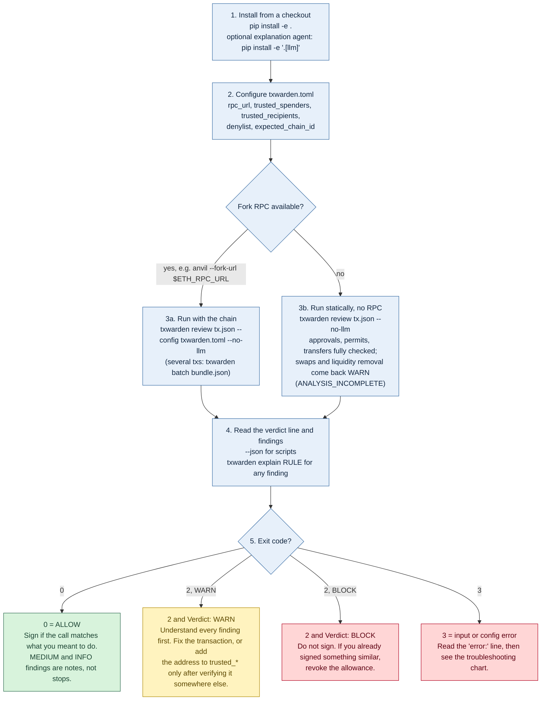
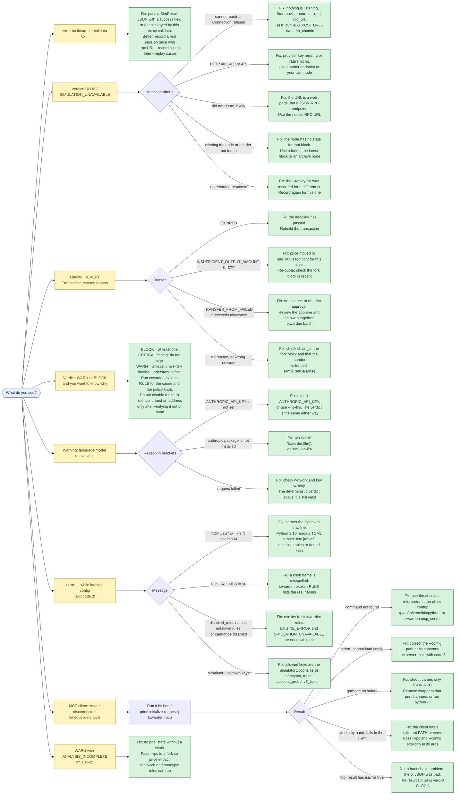

# Flowcharts

Two diagrams: how to use TxWarden, and what to do when it does not do what you expected. The
sources are Mermaid files in `docs/diagrams/` (GitHub renders the blocks below); the SVGs next to
them are produced by `scripts/render_diagrams.sh` and embedded in the README.

## Using TxWarden: install, configure, run, read, act

Mermaid source (docs/diagrams/usage.mmd)

<!-- BEGIN usage-mmd -->

<!-- END usage-mmd -->

Reading the exit code: **0** means ALLOW. **2** means WARN or BLOCK, so look at the `Verdict:` line
(or `"verdict"` in `--json`): BLOCK is "do not sign", WARN is "understand every finding first".
**3** means the input or configuration was wrong and nothing was reviewed.

## Troubleshooting: start from what you see

Mermaid source (docs/diagrams/troubleshooting.mmd)

<!-- BEGIN troubleshooting-mmd -->

<!-- END troubleshooting-mmd -->

The symptoms are the real messages the tool prints. In plain text:

| What you see | Cause | Fix |
|---|---|---|
| `error: no fixture for calldata 0x...` | the `--fixture` file has no entry for this calldata, or is not a `SimResult` | give it a `SimResult` JSON with a `success` field, or a `{calldata: SimResult}` table; or record a real session with `--rpc URL --record s.json` and `--replay s.json` |
| `Verdict: BLOCK` with `SIMULATION_UNAVAILABLE`, `cannot reach ...` | nothing listens at the RPC URL | start the node (`anvil --fork-url ...`) or correct `--rpc` / `rpc_url`; test with `curl -s -X POST URL -H 'content-type: application/json' --data '{"jsonrpc":"2.0","id":1,"method":"eth_chainId","params":[]}'` |
| `SIMULATION_UNAVAILABLE`, `HTTP 401/403/429` | provider key missing or rate limit | another endpoint or your own node |
| `SIMULATION_UNAVAILABLE`, `did not return JSON` | the URL is a web page, not a JSON-RPC endpoint | use the node's RPC URL |
| `SIMULATION_UNAVAILABLE`, `missing trie node` / `header not found` | the node has no state for that block | fork at the latest block or use an archive node |
| `SIMULATION_UNAVAILABLE`, `no recorded response` | the `--replay` file was recorded for a different transaction | record again |
| `REVERT` with `EXPIRED` | deadline passed | rebuild the transaction |
| `REVERT` with `INSUFFICIENT_OUTPUT_AMOUNT`, `K`, `STF` | price moved, or `min_out` is too tight at this block | re-quote; check the fork block |
| `REVERT` with `TRANSFER_FROM_FAILED` / allowance | no balance, or the approval is a separate transaction | review them together: `txwarden batch` |
| `REVERT` without a reason | wrong chain id, stale fork, unfunded sender | check `chain_id`, the fork block, `anvil_setBalance` |
| `Verdict: WARN` / `BLOCK`, why? | WARN = at least one HIGH finding, BLOCK = at least one CRITICAL | `txwarden explain RULE`; trust an address only after verifying it elsewhere; do not disable a rule to silence it |
| `ANALYSIS_INCOMPLETE` on a swap | no pool state without a chain | pass `--rpc` to a fork |
| `Warning: language model unavailable (ANTHROPIC_API_KEY is not set)` | no key | `export ANTHROPIC_API_KEY=...` or `--no-llm`; the verdict is identical |
| `... (the `anthropic` package is not installed ...)` | optional extra missing | `pip install 'txwarden[llm]'` or `--no-llm` |
| `error: ... unknown policy keys: [...]` | misspelled knob | `txwarden explain RULE` lists the real names |
| `error: ... disabled_rules names unknown rules` / `cannot be disabled` | typo, or a fail-closed rule | ids from `txwarden rules`; `ENGINE_ERROR` and `SIMULATION_UNAVAILABLE` stay on |
| `error: ... Invalid statement (at line N, column M)` | TOML syntax | fix that line; on Python 3.10 use `[tables]`, no inline tables or dotted keys |
| MCP client: disconnected, timeout, no tools | see below | run `printf '{"jsonrpc":"2.0","id":1,"method":"initialize","params":{}}\n' \| txwarden-mcp` by hand |
| `txwarden-mcp: error: cannot load config` on stderr | bad `--config` | fix the path or the file; the server exits with code 3 |
| MCP works by hand, not in the client | the client's `PATH` or venv differs | use `/path/to/venv/bin/python -m txwarden.mcp_server` and pass `--rpc` / `--config` explicitly |
| MCP tool result has `isError: true` | the transaction JSON was bad (not a handshake problem) | the result still says `"verdict": "BLOCK"`; fix the input |
